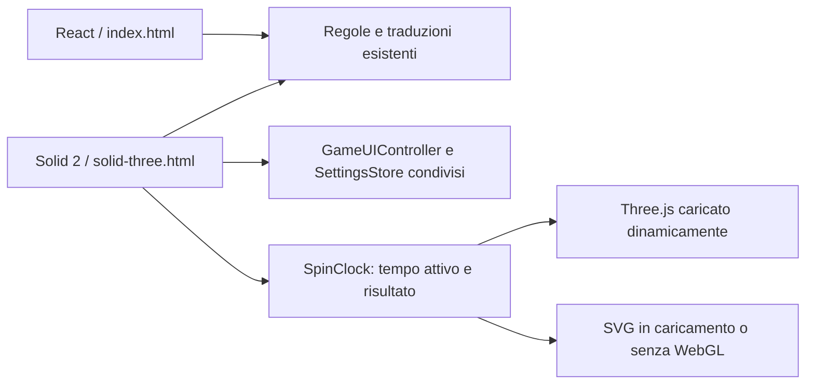

# Prova GiraTempo con Solid 2 e Three.js

La pagina `/solid-three.html` usa Solid 2.0.0-rc.16 e Three.js 0.186.1.
La pagina `/index.html` mantiene il gioco React/SVG. Il confronto è reversibile
cambiando pagina, senza migrare o cancellare preferenze e progressi.



La prova offre giorni e mesi, italiano e inglese, difficoltà condivisa, risposte
prima/dopo correggibili, rime locali, sintesi vocale del browser, effetti sonori,
tema, contrasto, schermo intero, tastiera e touch. Non avvia richieste AI.
Le preferenze usano lo stesso store versionato del gioco classico.

Il risultato si calcola indipendentemente dal renderer: tutti i centri dei 7 e
12 settori sono verificati contro la freccia, anche dopo giri consecutivi.
Impostazioni e visibilità sospendono il tempo del giro con motivi indipendenti.
La perdita di WebGL attiva la stessa ruota SVG senza cambiare il risultato.
Il renderer disegna solo su cambiamento, limita il pixel ratio a 1,5 e conserva
al massimo due modelli localizzati; texture, geometrie, materiali e listener
vengono liberati alla chiusura. Le animazioni ridotte accorciano il giro.

## Misure locali

Windows, Node 26.12, browser Chromium locale, build di produzione, 60 cambi
giorni/mesi alternati, audio disattivato e animazioni ridotte. La latenza misura
dal clic alla prima mutazione del DOM. Le operazioni/s sono il reciproco della
latenza media, **non** FPS o throughput sostenuto. Il browser di test disabilita
la GPU hardware: il risultato non stima le prestazioni di uno smartphone.
Le due pagine presentano layout diversi: questo non isola il costo dei framework.

| Versione | mean ms | p50 ms | p95 ms | ops/s | speedup sulla baseline |
|---|---:|---:|---:|---:|---:|
| React/SVG prima | 0,353 | 0,300 | 0,700 | 2830 | 1,00× |
| React/SVG dopo | 0,363 | 0,400 | 0,600 | 2752 | 0,97× |
| Solid/Three dopo | 1,497 | 0,900 | 1,900 | 668 | 0,24× |

L'azione resta rapida, ma il 3D costa più del menu classico. Una prima variante
che ricreava i modelli a ogni cambio misurava circa 23 ms; il riuso limitato
dei modelli ha eliminato questa ricostruzione ricorrente.

| JavaScript applicativo minificato | Prima | Dopo |
|---|---:|---:|
| Classico, totale dei chunk necessari | 278,01 kB | 277,78 kB |
| Prova, inclusi chunk 3D | — | 697,37 kB |
| Prova, gzip stimato dalla build | — | 192,30 kB |

I chunk Three non vengono richiesti dalla pagina classica. Sono esclusi dalla
tabella gli asset privacy condivisi e i CSS; i JSON del benchmark riportano
anche le risorse effettivamente scaricate. Le differenze inferiori al millisecondo
dipendono da scheduling e risoluzione del timer: nessuna promessa di accelerazione.

## Verifica e riproduzione

```sh
npm ci
npm run build
npm run test:kit
npm run test:experiment
npm run test:kit:browser
npm run test:experiment:browser
npm run benchmark:experiment
npm run preview -- --host 127.0.0.1
```

Il test browser verifica il vero renderer Three, viewport 1280/390/320 px,
touch reale tramite CDP, quattro partite bilingui complete, correzione degli
errori, doppio giro, pausa, perdita del contesto, WebGL negato all'avvio,
persistenza delle preferenze, Escape e ripristino del focus. Le stesse verifiche
sono aggiunte alla CI GitHub. Screenshot e misure sono in `artifacts/solid-three/`.
Per testare anche Vite dev impostare `TRIAL_BASE_URL=http://127.0.0.1:5173`.

## Limiti e prossime priorità

1. Provare leggibilità, consumo e fluidità su un telefono fisico, prima di
   scegliere il 3D come interfaccia principale. Raccomandazione prioritaria.
2. Alleggerire il caricamento Three se i dati di rete reali lo richiedono.
3. Aggiornare separatamente la toolchain esistente: `npm audit` segnala ancora
   nove vulnerabilità preesistenti tra Vite e Tailwind e dipendenze transitive.
   La prova non ne aggiunge; non applica aggiornamenti maggiori automatici.

Solid resta una release candidate e tutte le nuove dipendenze sono bloccate
a versioni esatte. Il compilatore Babel ufficiale permette di provare Solid 2
senza aggiornare Vite e l'intera applicazione React. Il precheck KB e CBMM è
stato eseguito sul NAS; l'indice NAS non copre questa repository Windows.
Il verificatore CI NAS è vincolato a un'altra repository: per questo progetto
si verificano direttamente le Actions GitHub sullo SHA pubblicato.

Fonti: [Solid 2 RC](https://github.com/solidjs/solid/discussions/2995),
[compilatore Babel ufficiale](https://github.com/solidjs/solid/tree/main/packages/babel-plugin),
[rendering Three su richiesta](https://threejs.org/manual/pages/rendering-on-demand.html).

## Ruota e selettore 3D: rifinitura del 21 ottobre

La ruota ha ora corpo estruso, doppio bordo metallico, rivetti istanziati e
mozzo con stella. Il selettore è un gruppo 3D con supporto, perno e lama
smussata: la flessione dipende da angolo e velocità angolare, senza dipendere
dal frame rate. A fine giro torna a riposo; il settore vincente è evidenziato
anche nel fallback SVG. Gli scatti sonori rispettano mute, canali e pausa.
Con movimento ridotto il risultato compare senza la sequenza di rotazioni.

I settori colorati sono uniti in una geometria; i rivetti condividono una
`InstancedMesh`. Il test browser misura 15 draw call a risultato visibile,
al massimo 30 geometrie e 3 texture, comprendendo la texture interna di Three,
attraverso quattro combinazioni di modalità e lingua. La cache mantiene due
modelli e rilascia le risorse del modello sostituito.

| Stesso carico di 60 cambi modalità | Prima rifinitura | Dopo rifinitura |
|---|---:|---:|
| mean ms | 1,488 | 1,575 |
| p50 ms | 0,800 | 0,900 |
| p95 ms | 2,300 | 1,800 |
| ops/s | 672 | 635 |
| speedup medio | 1,00× | 0,94× |

Il costo medio cresce del 5,8%, entro 0,1 ms in questo campione; il p95 cala
del 21,7%. Non è una misura di FPS o una garanzia di miglioramento prestazionale.
Il JavaScript gzip della prova passa da circa 192,3 a 196,1 kB.
Le evidenze riproducibili sono `benchmark-polish-before.json`,
`benchmark-polish-after.json` e `verification.json` in `artifacts/solid-three/`.
Passano test della matematica del puntatore, gioco completo e budget GPU sia
con la build di produzione sia con il server Vite di sviluppo.

## Selettore classico e menu Solid

La pagina classica espone un selettore 2D/3D con due destinazioni reali,
controlli di almeno 44 px e stato corrente accessibile. Le preferenze sono
condivise fra le pagine. Nella versione 3D anche toolbar, impostazioni e
conferma di ripristino sono componenti Solid 2 RC. Il kit comune conserva
i servizi di audio, fullscreen, input, tema e persistenza; il widget privacy
condiviso conserva la propria gestione.

La build percorre le dipendenze della pagina sperimentale e fallisce se
trova React o i suoi adapter. Verifica inoltre la presenza del runtime Solid
e del modulo impostazioni, emettendo `solid-runtime.json` come ricevuta.
Il test browser copre navigazione 2D/3D da tastiera, persistenza, conferma
annullabile, focus circolare comprendente i controlli privacy e geometria
del dialogo alle larghezze 1280, 390 e 320 px.

| 60 cambi modalità, stesso browser e carico | Prima menu Solid | Dopo |
|---|---:|---:|
| mean ms | 1,642 | 1,515 |
| p50 ms | 1,000 | 1,000 |
| p95 ms | 2,600 | 2,300 |
| ops/s | 609 | 660 |
| speedup medio | 1,00× | 1,08× |

Sono tempi locali fino alla prima mutazione DOM, soggetti al rumore del
browser; non isolano il costo dei menu e non dimostrano una superiorità del
framework. Il JavaScript gzip della prova cresce da circa 196,1 a 199,5 kB.
I dati sono `benchmark-solid-menus-before.json` e
`benchmark-solid-menus-after.json` in `artifacts/solid-three/`.
